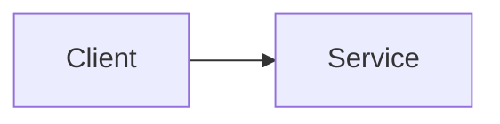
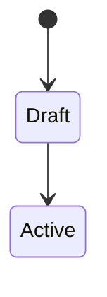

# Design: <Feature Name>

- **Slug:** <slug>
- **Status:** Draft | Approved
- **Date:** YYYY-MM-DD
- **Specs:** [02-specs.md](02-specs.md)
- **Source of truth consulted:** <CLAUDE.md, AGENTS.md, other docs>

## Overview
<One-paragraph summary of the chosen approach.>

## Approaches considered

| Approach | How it works | Reuses | Pros | Cons | Effort |
|---|---|---|---|---|---|
| A (chosen) | | | | | |
| B | | | | | |

## Architecture

## Components

| Component | Responsibility | Path | New / changed | Reuses |
|---|---|---|---|---|
| <name> | <responsibility> | `path/to/module` | new | <existing helper> |

## Data model

### <Entity>

| Field | Type | Constraints | Notes |
|---|---|---|---|
| <field> | <type> | <unique / not null / FK> | |

- **Indexes:** <index and the query it serves>
- **Deletion behaviour:** <soft/hard delete, cascades>
- **Migrations:** <order, owner, safe on live data?>
- **Backfill / data migration:** <plan, or "none">

## State machines

- **Illegal transitions:** <and how they are rejected>
- **Cancellation / partial failure / retries / idempotency:** <handling>

## Interfaces

### <Endpoint / function / event>
- **Request:** <shape and validation>
- **Response:** <shape>
- **Errors:** <code → condition>
- **Versioning / contract docs to update:** 

## External integrations
- <Service> — <calls / webhooks> — <timeouts, retries, idempotency keys> — <failure behaviour>

## Permissions
- <Action> — enforced in `<path>` via <mechanism>

## Concurrency and consistency
<Transactions, locking, race conditions, how invariants hold.>

## Error handling
- <Failure mode> → <surfaced / retried / rolled back how>

## Security and privacy
<Authn/authz, validation, secrets, PII, abuse cases.>

## Performance
- NFR-1 → <how the target is met; queries, caching, invalidation, N+1 risks>

## Observability and audit
- **Logs / metrics / traces:** <what>
- **Alerts:** <what>
- **Audit events:** <what>

## UX implementation
<Flows, empty/loading/error states, responsive layouts, accessibility, using which UI patterns.>

## Rollout and rollback
1. <Step> — rollback: <how>

## Testing strategy

| Level | What it proves | Requirements |
|---|---|---|
| Unit | | FR-1 |
| Integration | | FR-2, NFR-1 |

## Source-of-truth impact
- <Change needed to CLAUDE.md / AGENTS.md / docs, or "none">

## Requirement mapping

| Requirement | Design elements |
|---|---|
| FR-1 | <component / interface / data> |

## Decisions

### D-1: <Title>
- **Date:** YYYY-MM-DD
- **Context:** <why a decision was needed>
- **Decision:** <what we chose>
- **Alternatives rejected:** <and why>
- **Consequences:** <trade-offs accepted>

## Risks
- <Risk> — <likelihood / impact> — <mitigation or spike>

## Assumptions
- <Default applied without asking, so it can be vetoed>

## Open questions
- <Question> → <answer once resolved>
